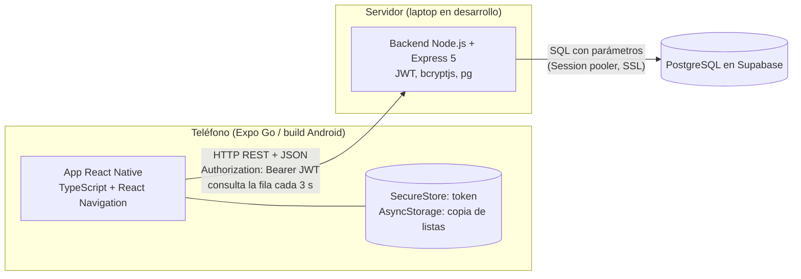

# Arquitectura de SpeakUp

SpeakUp es una aplicación **cliente-servidor de 3 capas**. El backend es un **monolito**: un solo
servidor Express con toda la lógica, organizado por rutas (D21).

| Capa | Tecnología | Qué hace |
|---|---|---|
| Presentación | React Native con Expo SDK 58, TypeScript strict | Pantallas, validación de formularios, estado de la sesión, funciones nativas (compartir, notificación, cámara). |
| Lógica | Node.js + Express 5 | Autenticación con JWT, permisos por rol, reglas de la fila y del historial. Toda regla importante se valida aquí, aunque la app también la revise (D08). |
| Datos | PostgreSQL en Supabase | Usuarios, clases, sesiones, inscripciones y turnos. Las restricciones (índices únicos parciales, `CHECK`, `ON DELETE CASCADE`) protegen los datos aunque falle el código. |

## Decisiones que definen la arquitectura
- **Polling cada 3 segundos en lugar de WebSockets (D22):** la fila se actualiza pidiéndola al servidor.
  Es más simple, funciona igual en el teléfono y en el navegador, y 3 segundos basta en un salón.
- **`pg` con consultas parametrizadas en lugar de un ORM (D20):** los valores van como `$1, $2`,
  nunca pegados al texto del SQL, así que no hay inyección SQL.
- **Transacciones** cuando una acción cambia varias filas (terminar clase, dar la palabra, iniciar clase):
  o se hacen todos los cambios, o ninguno.
- **Copia local (D34):** las listas se guardan en el teléfono para verlas sin internet.

## Dónde está cada cosa

### Backend (`backend/`)
| Archivo | Qué contiene |
|---|---|
| `index.js` | Punto de entrada: carga el `.env`, exige `JWT_SECRET` y abre el puerto. |
| `app.js` | La app de Express: monta las rutas y tiene registro, login y perfil. Las pruebas de integración la cargan sin abrir el puerto. |
| `db.js` | Conexión a PostgreSQL (`DATABASE_URL`). |
| `authMiddleware.js` | `verificarToken` (401) y `exigirRol` (403). |
| `utils.js` | `validarMateria`, `generarCodigo` y `conCodigoUnico` (reintenta si el código se repite, D16). |
| `src/middleware/clases.js` | `cargarClase` y `cargarClasePropia`: buscan la clase del `:id` y revisan al dueño. |
| `src/routes/clases.js` | Crear, listar, editar, iniciar, terminar y eliminar clases; unirse con código. |
| `src/routes/fila.js` | La fila: pedir la palabra, salir, ver la fila, dar la palabra. |
| `src/routes/alumno.js` | Mis clases del alumno e historial paginado. |
| `schema.sql` / `setupDb.js` | Tablas e índices; se aplican con `node setupDb.js` (idempotente, D17). |
| `__tests__/` | Pruebas con `node --test`: unitarias (`utils.test.js`) y de integración de la API (`api.test.js`). |

### Frontend (`frontend/`)
| Carpeta o archivo | Qué contiene |
|---|---|
| `App.tsx` | Arma la app: área segura, `AuthProvider` y navegación. |
| `src/navigation/` | `AppNavigator.tsx` (Stack + Tabs + Modal, según el rol) y `tipos.ts` (parámetros de cada pantalla). |
| `src/context/AuthContext.tsx` | Estado global: usuario, iniciar y cerrar sesión, salir con un 401. |
| `src/services/api.ts` | Cliente axios: URL base, token en cada petición y mensajes de error. |
| `src/services/almacenamiento.ts` | Guarda el token (SecureStore en el teléfono, localStorage en web). |
| `src/services/cache.ts` | Copia local de listas con AsyncStorage. |
| `src/services/notificaciones.ts` | Notificación local cuando llega tu turno. |
| `src/hooks/usePolling.ts` | Repite una petición cada 3 s mientras la pantalla está visible. |
| `src/screens/auth/` | Login y Registro. |
| `src/screens/docente/` | Mis clases, formulario de clase y sesión del docente (código, QR, fila). |
| `src/screens/alumno/` | Unirse, escáner QR, fila del alumno, Mis clases e historial. |
| `src/screens/PerfilScreen.tsx` | Perfil y cerrar sesión. |
| `src/components/` | Componentes propios: `Pantalla`, `Boton`, `Campo`, `ModalOpciones`, `Icono`, `Logo` (D25). |
| `src/utils/` | Funciones puras: validaciones de formularios y fechas ("Hoy", "Ayer"). |
| `__tests__/` | Pruebas unitarias de `src/utils/` con `node --test`. |
| `src/theme.ts` / `src/types.ts` | Colores y espacios del Figma; tipos de los datos de la API. |

### Documentación
| Ruta | Qué contiene |
|---|---|
| `specs/` | Specs (SDD): proyecto, navegación, modelo de datos y una por feature. |
| `specs/decisiones.md` | Diario de decisiones (D01 en adelante). |
| `specs/bitacora-ia.md` | Bitácora de uso de IA. |
| `docs/api.md` | Documentación de los endpoints. |
